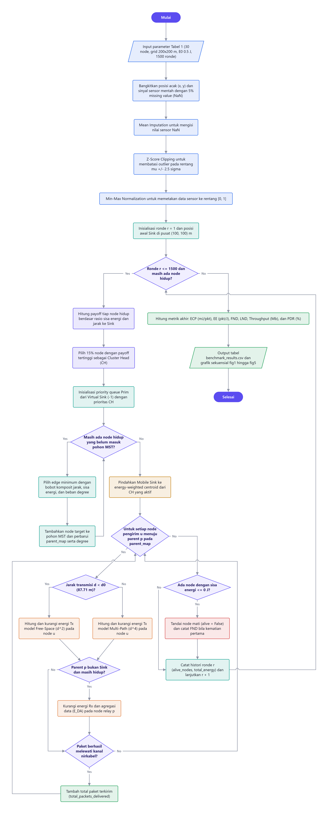
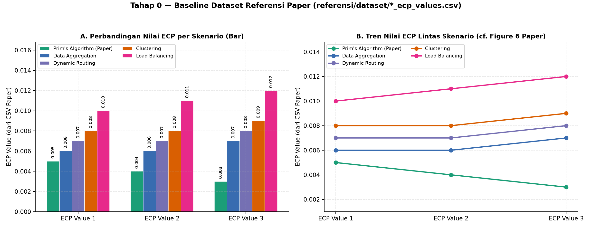
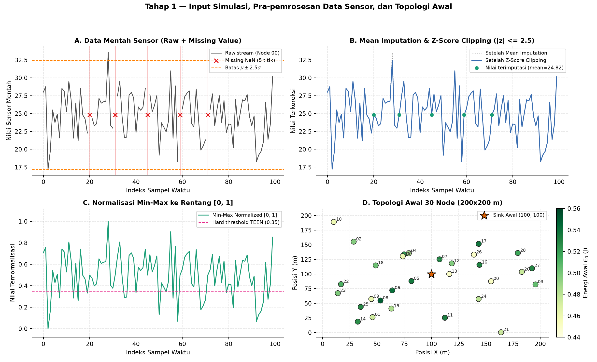
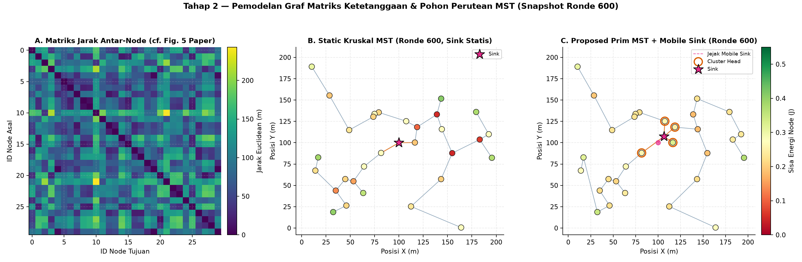
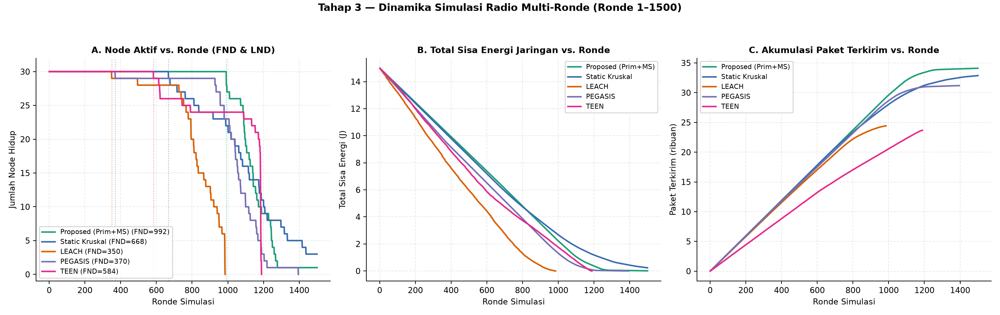
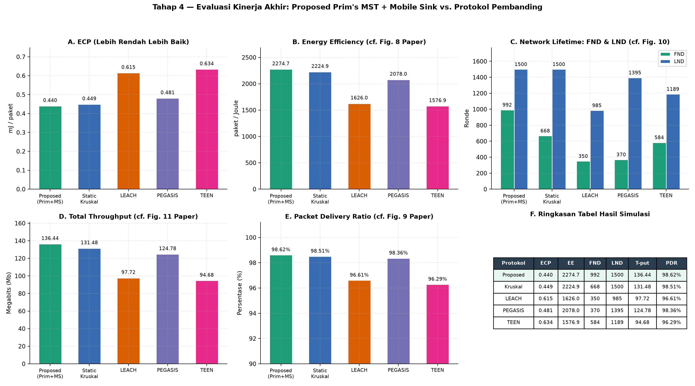

# Optimasi Keseimbangan Energi pada Wireless Sensor Network (WSN)

Repositori ini mendokumentasikan studi dan rekonstruksi simulasi untuk topik **optimasi keseimbangan energi pada *Wireless Sensor Network* (WSN)** dengan merujuk pada artikel ilmiah:

> Saad HM, Shdefat A, Nawaz A, El-Sherbeeny AM, El-Meligy MA, Rana MRR (2024). *Enhancing energy balance in wireless sensor networks through optimized minimum spanning tree*. **PeerJ Computer Science**, 10:e2269 (PMCID: `PMC11623227`, DOI: `10.7717/peerj-cs.2269`).


## Struktur Direktori

```text
fp-tegraf/
├── README.md
├── referensi/                               # Artefak suplemen asli dari paper
│   ├── codeeee.py                           # Kerangka dasar Kruskal MST (4 node statis)
│   ├── peerj-cs-10-2269-s003.m              # Script MATLAB MST statis (50 node, 100x100)
│   └── dataset/                             # Data nilai ECP referensi (3 skenario per metode)
│       ├── prim's_algorithm_ecp_values.csv
│       ├── data_aggregation_ecp_values.csv
│       ├── dynamic_routing_ecp_values.csv
│       ├── clustering_ecp_values.csv
│       └── load_balancing_ecp_values.csv
└── kelompok/                                # Rekonstruksi simulasi & visualisasi kelompok
    ├── flowchart_wsn.ddr                    # Diagram alur DDR (untuk editor ddrplatform.my.id)
    ├── simulation.py                        # Simulator WSN lengkap (5 protokol pembanding)
    ├── visualize.py                         # Pipeline pembangkit grafik berurutan (Tahap 0-4)
    └── output/                              # Keluaran grafik & tabel hasil simulasi
        ├── benchmark_results.csv
        ├── fig1_referensi_ecp_paper.png
        ├── fig2_tahap1_preprocessing.png
        ├── fig3_tahap2_graf_dan_topologi.png
        ├── fig4_tahap3_dinamika_ronde.png
        ├── fig5_tahap4_evaluasi_metrik.png
        └── flowchart.png
```

Tautan berkas utama:
- Referensi: [codeeee.py](file:///d:/Kuliah/Tugas/Tegraf/fp-tegraf/referensi/codeeee.py), [peerj-cs-10-2269-s003.m](file:///d:/Kuliah/Tugas/Tegraf/fp-tegraf/referensi/peerj-cs-10-2269-s003.m), [prim's_algorithm_ecp_values.csv](file:///d:/Kuliah/Tugas/Tegraf/fp-tegraf/referensi/dataset/prim's_algorithm_ecp_values.csv)
- Kelompok: [flowchart_wsn.ddr](file:///d:/Kuliah/Tugas/Tegraf/fp-tegraf/kelompok/flowchart_wsn.ddr), [simulation.py](file:///d:/Kuliah/Tugas/Tegraf/fp-tegraf/kelompok/simulation.py), [visualize.py](file:///d:/Kuliah/Tugas/Tegraf/fp-tegraf/kelompok/visualize.py), [benchmark_results.csv](file:///d:/Kuliah/Tugas/Tegraf/fp-tegraf/kelompok/output/benchmark_results.csv)

---

## Kerangka Konseptual (*Top-Down Pipeline*)

Secara keseluruhan, alur simulasi yang direkonstruksi mengikuti lima tahapan berurutan mulai dari penelaahan data referensi hingga evaluasi metrik kinerja jaringan.



---

## Penjelasan Sekuensial Tiap Tahap

### Tahap 0 — Tinjauan Artefak Referensi Paper

Berkas suplemen yang tersedia pada direktori `referensi/` terdiri atas tiga jenis materi:
1. [codeeee.py](file:///d:/Kuliah/Tugas/Tegraf/fp-tegraf/referensi/codeeee.py): implementasi contoh algoritma *Kruskal's Minimum Spanning Tree* pada graf sederhana berisi 4 simpul statis.
2. [peerj-cs-10-2269-s003.m](file:///d:/Kuliah/Tugas/Tegraf/fp-tegraf/referensi/peerj-cs-10-2269-s003.m): simulasi MATLAB statis untuk 50 node pada area $100 \times 100$ yang membangun matriks jarak Euclidean, mencari MST melalui `minspantree`, menghitung pengurangan energi linier per jarak, dan memvisualisasikan pohon MST.
3. Lima berkas CSV di `referensi/dataset/`: rekaman ringkas nilai *Energy Consumed per Packet* (ECP) untuk tiga skenario (`ECP Value 1` hingga `ECP Value 3`), yang menggambarkan perbandingan performa Prim's Algorithm terhadap pendekatan lain pada **Figure 6** di paper.



Karena kode suplemen asli belum mencakup simulasi multi-ronde, pra-pemrosesan data sensor, maupun mekanisme *Mobile Sink* yang dibahas dalam naskah paper, kelompok menyusun rekonstruksi simulasi yang lebih utuh pada [simulation.py](file:///d:/Kuliah/Tugas/Tegraf/fp-tegraf/kelompok/simulation.py).

---

### Tahap 1 — Input & Pra-pemrosesan Data Sensor

Pada fungsi `generate_and_preprocess_input` di [simulation.py](file:///d:/Kuliah/Tugas/Tegraf/fp-tegraf/kelompok/simulation.py#L48-L94), konfigurasi jaringan dibangkitkan sesuai parameter **Tabel 1** pada paper:
- Jumlah node: $N = 30$ node statis pada area $200 \times 200\text{ m}$ (`seed=42`).
- Energi baterai awal heterogen ringan: $E_0 \in [0.45, 0.55]\text{ J}$ (rata-rata $0.5\text{ J}$), dengan posisi awal *Sink* di pusat area $(100, 100)\text{ m}$.
- Pembacaan data sensor disimulasikan sebanyak 100 sampel waktu dengan sekitar $5\%$ nilai hilang (`NaN`), lalu dibersihkan melalui tiga langkah berurutan:
  1. ***Mean Imputation***: mengisi nilai `NaN` dengan rata-rata kolom sampel node bersangkutan.
  2. ***Z-Score Clipping***: membatasi nilai ekstrem (*outlier*) di luar rentang $\mu \pm 2.5\sigma$.
  3. ***Min-Max Normalization***: memetakan seluruh pembacaan bersih ke rentang terstandar $[0, 1]$.



---

### Tahap 2 — Pemodelan Graf, Pemilihan Cluster Head, dan Prim's MST + Mobile Sink

Tahap konstruksi rute membandingkan pembentukan pohon berbasis jarak murni (**Static Kruskal MST**, mereplikasi konsep kode referensi) dengan pendekatan yang diusulkan (**Energy-Aware Prim's MST + Mobile Sink**):

1. **Pemilihan *Cluster Head* (CH) Berbasis *Game Theory***: setiap node hidup mengevaluasi nilai *payoff*:
   $$\text{Payoff}_i = \frac{(E_i / E_{\text{init}})^{1.5}}{d(i, \text{Sink}) / d_{\max}}$$
   Sebanyak $15\%$ node dengan *payoff* tertinggi dipilih sebagai CH yang diprioritaskan terhubung langsung ke *Sink*.
2. **Konstruksi *Energy-Aware Prim's MST*** (`build_energy_aware_prim_mst`): alih-alih hanya meminimalkan jarak Euclidean, bobot *edge* dari node $v$ ke calon anak `nxt` mempertimbangkan tiga faktor:
   $$w(v, \text{nxt}) = 0.50 \cdot \frac{d(v, \text{nxt})}{d_{\max}} + 0.35 \cdot \left(1 - \frac{\min(E_v, E_{\text{nxt}})}{1.1 E_{\text{init}}}\right) + 0.15 \cdot \frac{\text{degree}(v)}{N_{\text{alive}}}$$
   Dengan formulasi ini, jalur transmisi diarahkan menjauhi node yang baterainya menipis atau sudah menanggung beban anak (*degree*) terlalu banyak.
3. **Pembaruan Posisi *Mobile Sink*** (`optimize_mobile_sink_position`): pada setiap ronde, *Sink* bergeser menuju titik pusat bobot energi (*energy-weighted centroid*) dari CH yang aktif agar jarak lompatan utama tetap seimbang.



Pada *snapshot* Ronde 600 di atas terlihat perbedaan mendasar antara kedua pohon: pada **Static Kruskal MST** (Panel B), beberapa node *relay* di dekat pusat area mengalami pengurasan energi parah (merah) karena topologi rute tetap tidak berubah, sedangkan pada **Proposed Prim MST + Mobile Sink** (Panel C), pergeseran *Mobile Sink* dan pembaruan rute menjaga distribusi sisa energi relatif lebih seragam.

---

### Tahap 3 — Simulasi Disipasi Energi Radio Multi-Ronde

Simulasi dijalankan selama $1500$ ronde (`packet_bits = 4000` bit/paket) menggunakan ***First-Order Radio Dissipation Model*** (`calc_tx_energy` dan `calc_rx_energy`):
- Jarak ambang kanal: $d_0 = \sqrt{E_{\text{fs}} / E_{\text{mp}}} \approx 87.71\text{ m}$.
- Energi transmisi mengikuti model *free-space* ($d^2$) apabila $d < d_0$, atau *multi-path fading* ($d^4$) apabila $d \ge d_0$.
- Node penerima/relay turut menanggung biaya penerimaan ($E_{\text{elec}}$) dan agregasi data ($E_{\text{DA}} = 5\text{ nJ/bit}$).



Grafik dinamika per ronde memperlihatkan bahwa kurva node aktif **Proposed (Prim+MS)** mampu bertahan utuh (30 node hidup) hingga ronde ke-992 sebelum node pertama mati (*First Node Dies*, FND), jauh lebih lama dibanding **Static Kruskal** (ronde 668), **TEEN** (ronde 584), **PEGASIS** (ronde 370), dan **LEACH** (ronde 350).

---

### Tahap 4 — Evaluasi & Komparasi Kinerja Protokol

Rekonstruksi membandingkan lima protokol sekaligus pada skenario jaringan yang identik (`seed=42`, $N=30$, $1500$ ronde). Hasil lengkap yang tercatat pada [benchmark_results.csv](file:///d:/Kuliah/Tugas/Tegraf/fp-tegraf/kelompok/output/benchmark_results.csv) adalah sebagai berikut:

| Protokol | ECP (mJ/pkt) ↓ | EE (pkt/J) ↑ | FND (Ronde) ↑ | LND (Ronde) ↑ | Throughput (Mb) ↑ | PDR (%) ↑ |
| :--- | :---: | :---: | :---: | :---: | :---: | :---: |
| **Proposed (Prim MST + Mobile Sink)** | **0.440** | **2274.7** | **992** | **1500** | **136.44** | **98.62%** |
| Static Kruskal MST (Paper Code) | 0.449 | 2224.9 | 668 | 1500 | 131.48 | 98.51% |
| LEACH (Clustering) | 0.615 | 1626.0 | 350 | 985 | 97.72 | 96.61% |
| PEGASIS (Chain Multi-Hop) | 0.481 | 2078.0 | 370 | 1395 | 124.78 | 98.36% |
| TEEN (Threshold Routing) | 0.634 | 1576.9 | 584 | 1189 | 94.68 | 96.29% |



---

## Tinjauan Objektif & Batasan Rekonstruksi

Sebagai bahan kajian akademis yang objektif, beberapa hal penting perlu dicatat mengenai hasil simulasi ini:

1. **Mengapa FND meningkat signifikan (`992` vs. `668`), sementara selisih ECP antar-MST relatif tipis (`0.440` vs. `0.449 mJ/pkt`)?**  
   Secara matematis, MST berbasis jarak Euclidean murni (Static Kruskal) selalu menghasilkan total panjang *edge* minimum pada satu ronde statis. Sebaliknya, `build_energy_aware_prim_mst` secara sadar melakukan kompromi (*trade-off*) dengan memilih jalur yang sedikit lebih panjang demi menghindari node dengan baterai rendah atau *degree* tinggi. Konsekuensinya, energi rata-rata per paket (ECP) hanya turun tipis ($\approx 2\%$), tetapi beban energi tersebar jauh lebih merata sehingga kematian node pertama (FND) tertunda hingga $\approx 48.5\%$ lebih lama dibanding Static Kruskal.
2. **Perbedaan skala nilai ECP pada CSV referensi (`0.003–0.012`) dengan hasil simulasi (`0.440–0.634 mJ/pkt`)**  
   Kelima berkas CSV pada `referensi/dataset/` menyajikan angka ECP ternormalisasi/ringkas tanpa menyertakan kode simulasi penuh yang memproduksinya. Oleh sebab itu, simulasi pada `kelompok/simulation.py` tidak berusaha menyesuaikan angka secara paksa agar sama persis dengan CSV, melainkan menghitung ECP secara fisik dari model disipasi radio standar ($E_{\text{elec}}, E_{\text{fs}}, E_{\text{mp}}, E_{\text{DA}}$) dalam satuan milijoule per paket (`mJ/pkt`).
3. **Asumsi dan penyederhanaan model**  
   - Aliran data sensor (`raw_stream`) dibangkitkan secara sintetis berbasis distribusi normal (`seed=42`), bukan dari rekaman perangkat keras WSN lapangan.
   - Model kanal nirkabel menggunakan probabilitas kehilangan paket sederhana berbasis jarak (`base_pdr_loss`), tanpa menyimulasikan interferensi MAC layer atau tabrakan paket.
   - Parameter pembobotan pada Prim's MST (`0.50`, `0.35`, `0.15`) dan faktor bonus CH (`0.35`) merupakan rancangan heuristik rekonstruksi kelompok untuk merepresentasikan mekanisme *load balancing* yang dideskripsikan secara konseptual pada paper.

---

## Panduan Eksekusi Ulang

Seluruh hasil tabel dan grafik dapat direproduksi dari direktori akar repositori (`fp-tegraf/`) menggunakan Python 3 dengan pustaka `numpy` dan `matplotlib`:

```powershell
# 1. Menjalankan simulasi benchmark dan mencetak tabel hasil ke terminal
python kelompok/simulation.py

# 2. Membangkitkan seluruh grafik alur (Tahap 0–4) dan mengekspor benchmark_results.csv
python kelompok/visualize.py
```
